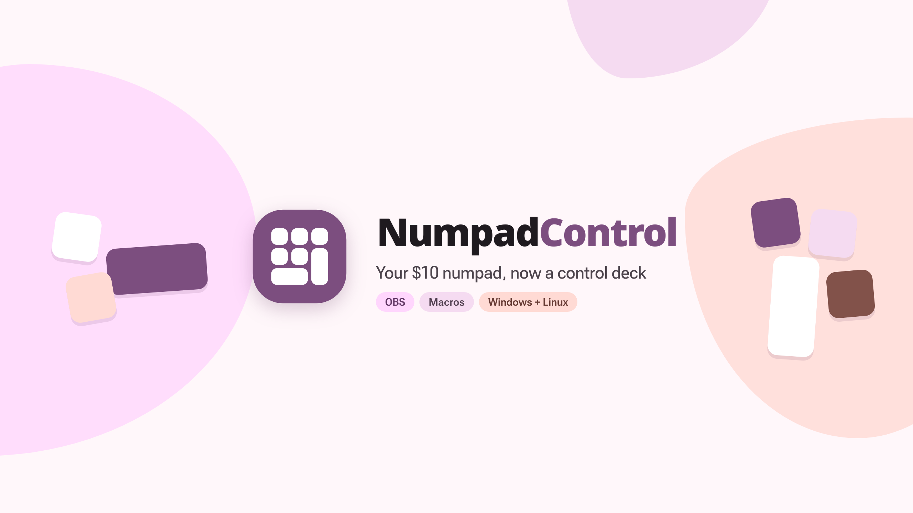
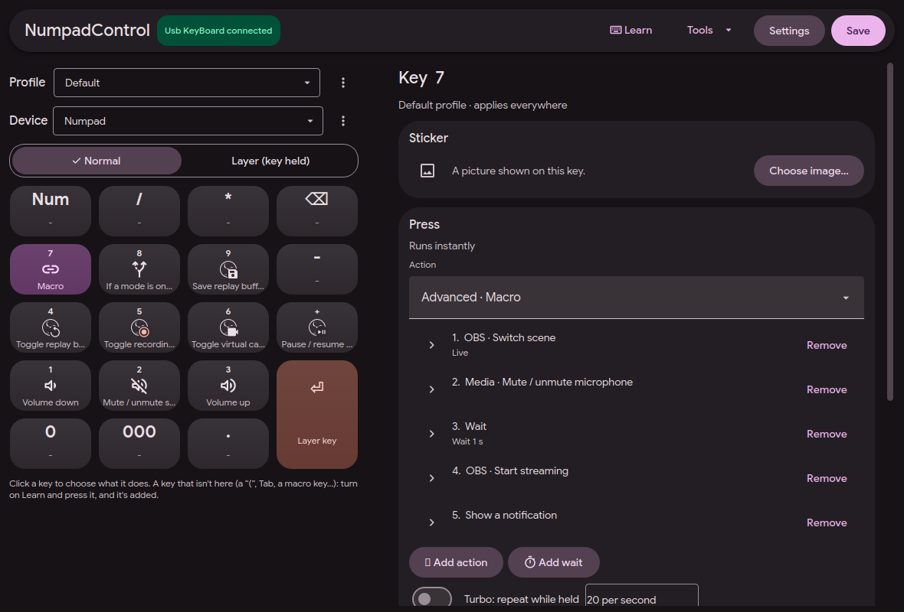

# NumpadControl

Turn a cheap USB numpad into a Stream Deck-style control pad on Linux and Windows.
Each key can open apps, control OBS, mute your mic, switch windows, type text or run a macro.
You set it up in a settings window, no code needed. Free and open source (GPL-3.0).

## Install

**Linux**

    curl -fsSL https://raw.githubusercontent.com/youssefahmed2017/numpad-control/main/setup.sh | bash

**Arch Linux (AUR)**

    yay -S numpad-control

**Windows** (PowerShell)

    irm https://raw.githubusercontent.com/youssefahmed2017/numpad-control/main/setup.ps1 | iex

On Windows you can also use the installer from [Releases](https://github.com/youssefahmed2017/numpad-control/releases)
(`winget install YoussefAhmed.NumpadControl` once it is in winget). It is not code-signed yet,
so SmartScreen may warn: choose *More info, then Run anyway*.

Then open **NumpadControl** from your app menu, click a key, pick an action, Save.

Tested on Arch Linux with Hyprland, KDE Plasma 6 and XFCE, on GNOME (Wayland, with limits)
and on Windows (newer, still being tested). Website:
[youssefahmed2017.github.io/numpad-control](https://youssefahmed2017.github.io/numpad-control/).

## Docs
- [Features and every action](docs/features.md): keys, macros, profiles, layers, modes, OBS, appearance
- [Installing in detail](docs/install.md): what the installers do, options, numpads that need replugging
- [Linux desktops](docs/linux-details.md): what works on Hyprland, KDE, X11 and GNOME
- [Troubleshooting](docs/troubleshooting.md), [updates and release notes](docs/updates.md)
- [Development](docs/development.md): code layout and tests. Security: [SECURITY.md](SECURITY.md)

## Support the project
NumpadControl is free and stays free: every key, every action, no ads, no account. If it saved you time and you'd
like to say thanks, you can leave a tip on **[Ko-fi](https://ko-fi.com/youssefahmedabdou)**. It is optional and unlocks nothing.

## License
[GPL-3.0](LICENSE). Parts it uses keep their own licenses (PySide6 under the LGPL, evdev, obsws-python, pystray, pycaw,
and on Windows, only if you choose it, the Interception driver).
