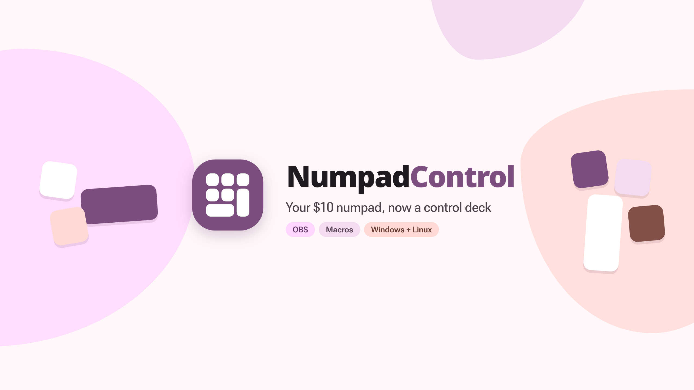
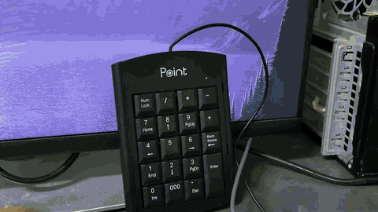
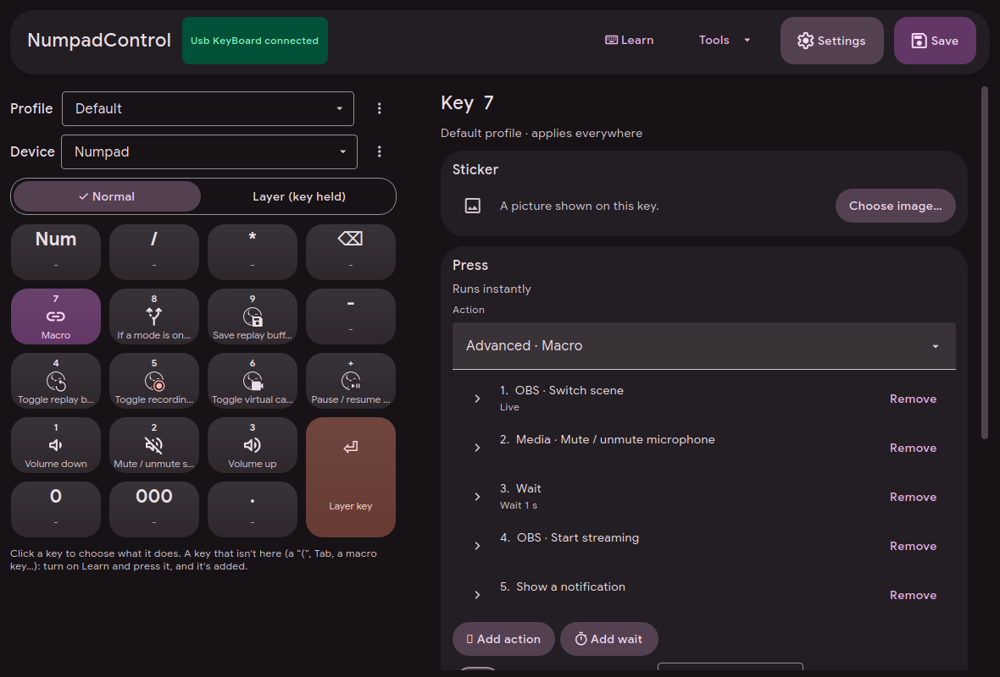

# NumpadControl

Turn a cheap USB numpad into a Stream Deck-style control pad on Linux and Windows.
Each key can open apps, control OBS, mute your mic, switch windows, type text or run a macro.
You set it up in a settings window, no code needed. Free and open source (GPL-3.0).

## Why use it
A Stream Deck costs $150 and a numpad costs $10. NumpadControl gives the numpad the same job, and a few things more:

- **Every key does three things.** Press, hold and double tap are separate actions, so 19 keys give you 57. Hold a
  layer key and you get a second set on top.
- **It changes with the app you are in.** Per-app profiles swap the whole pad when a window is focused (OBS, your
  editor, a game), and profile sets switch whole setups ("Coding", "Streaming") from one key.
- **Real streaming control.** Start and stop OBS recording and streaming, switch scenes, show or hide a source, mute
  an audio source and toggle filters, all from keys, with no window focus needed.
- **Macros and logic.** Chain actions with waits, wait for a window to appear, and branch with "if a mode is on…". Write
  your own templates in Python if you want to.
- **A panic button.** One press mutes the mic and speakers, pauses the media and hides every window. Another press
  puts it all back.
- **Voice changer and soundboard on a key,** per-app volume (Spotify, Firefox), and a switch for your audio output.
- **Any keyboard can be a pad too (Linux).** Turn a spare keyboard into a second control pad.
- **Made to look good.** Material 3 theming that follows your wallpaper or pywal, a see-through key map overlay, and
  stickers and icon packs.
- **Safe by default.** Sleep, shut down and restart need confirming, imported profiles show what they will do before they
  are added, and nothing needs an account.

New to it? Try the [recipes](docs/recipes.md): a stream deck, a mic panic button and a coding pad in a few minutes each.

## Install

**Linux**

    curl -fsSL https://raw.githubusercontent.com/youssefahmed2017/numpad-control/main/setup.sh | bash

**Arch Linux (AUR)**

    yay -S numpad-control

**Windows** (PowerShell)

    irm https://raw.githubusercontent.com/youssefahmed2017/numpad-control/main/setup.ps1 | iex

On Windows you can also use the installer from [Releases](https://github.com/youssefahmed2017/numpad-control/releases)
(`winget install YoussefAhmed.NumpadControl` once it is in winget). It is not code-signed yet,
so SmartScreen may warn: choose *More info, then Run anyway*.

Then open **NumpadControl** from your app menu, click a key, pick an action, Save.

Tested on Arch Linux with Hyprland, KDE Plasma 6 and XFCE, on GNOME (Wayland, with limits)
and on Windows (newer, still being tested). Website:
[numpad.ahmedabdou.net](https://numpad.ahmedabdou.net/).

## Docs
- [Features and every action](docs/features.md): keys, macros, profiles, layers, modes, OBS, appearance
- [Recipes](docs/recipes.md): ready-to-follow setups (streaming, mic panic button, coding pad, game pad)
- [Installing in detail](docs/install.md): what the installers do, options, numpads that need replugging
- [Linux desktops](docs/linux-details.md): what works on Hyprland, KDE, X11 and GNOME
- [Troubleshooting](docs/troubleshooting.md), [updates and release notes](docs/updates.md)
- [Development](docs/development.md): code layout and tests. Security: [SECURITY.md](SECURITY.md)
- [Roadmap](ROADMAP.md) and [changelog](CHANGELOG.md): what is planned, and what changed in each release

## Support the project
NumpadControl is free and stays free: every key, every action, no ads, no account. If it saved you time and you'd
like to say thanks, you can leave a tip on **[Ko-fi](https://ko-fi.com/youssefahmedabdou)**. It is optional and unlocks nothing.

## License
[GPL-3.0](LICENSE). Parts it uses keep their own licenses (PySide6 under the LGPL, evdev, obsws-python, pystray, pycaw,
and on Windows).
