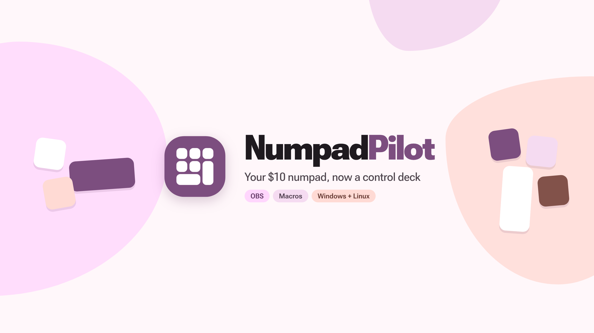
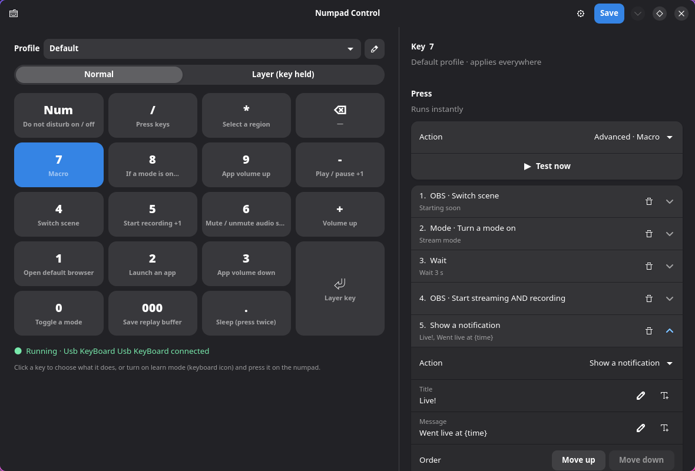
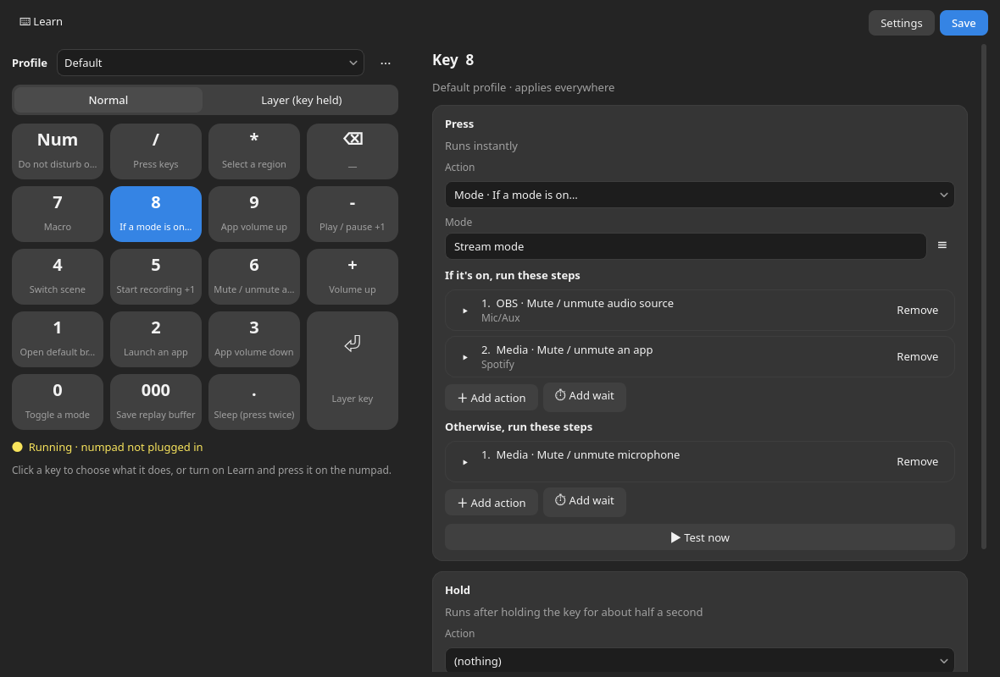
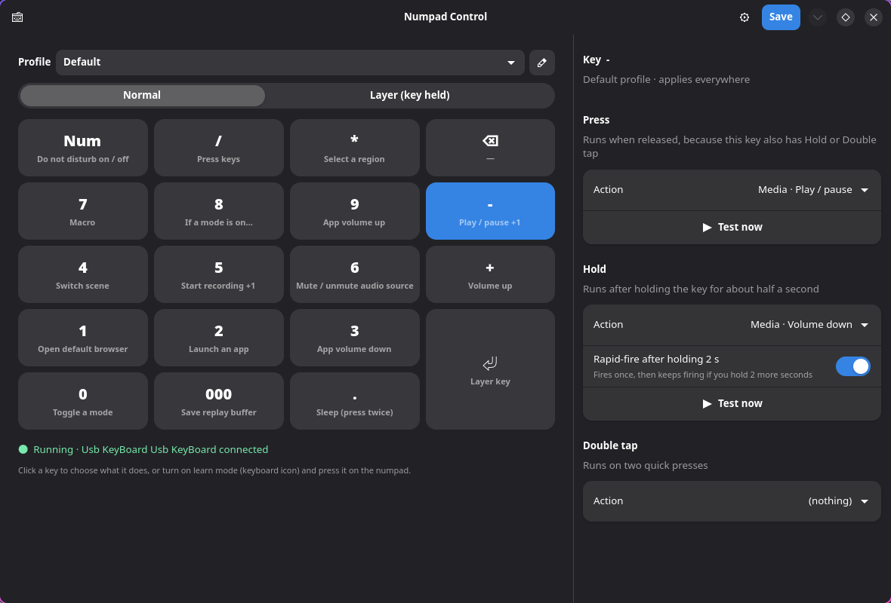
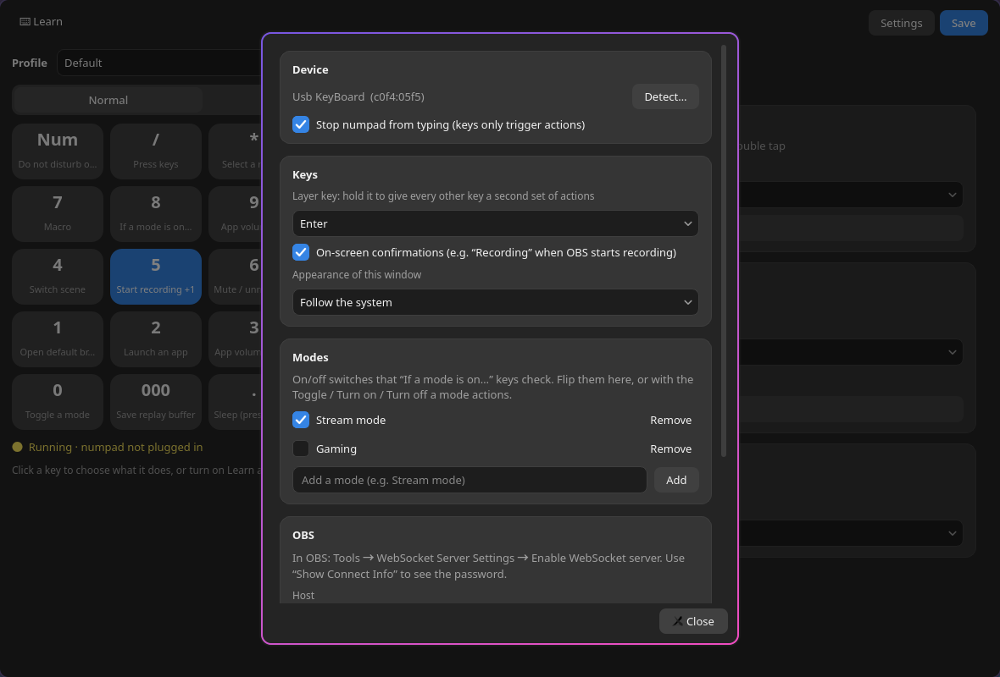
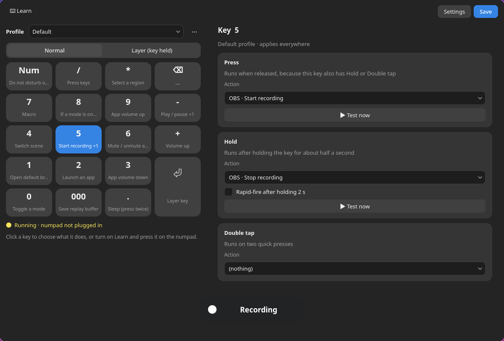
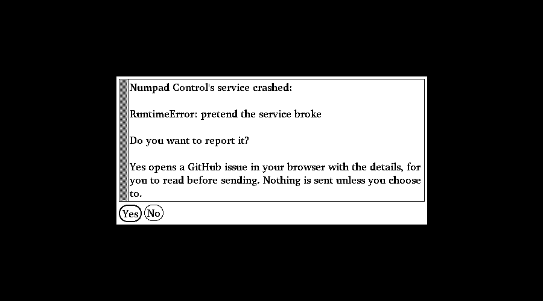

# NumpadPilot

Turns a cheap USB numpad into a control pad (like a Stream Deck) on Linux and Windows.
Website: **[youssefahmed2017.github.io/numpad-pilot](https://youssefahmed2017.github.io/numpad-pilot/)**.
Each key runs an action: open apps and websites, control OBS, media and volume,
manage windows and desktops, type text, run multi-step macros, and more.
Everything is set up in the settings window (the same on Linux and Windows; no code
needed). NumpadPilot is free and open source: the service, the settings window and
everything else are in this repository, under the GPL-3.0.

Built and tested on Arch Linux with **Hyprland** and **KDE Plasma 6** (Wayland), and on
**Windows** (newer: its installer and some of its actions are still being tested).

## Install
**Linux** (in a terminal, as your normal user):

    curl -fsSL https://raw.githubusercontent.com/youssefahmed2017/numpad-pilot/main/setup.sh | bash

**Windows** (in PowerShell, as your normal user):

    irm https://raw.githubusercontent.com/youssefahmed2017/numpad-pilot/main/setup.ps1 | iex

**Windows installer** (no PowerShell needed; once it is in winget):

    winget install YoussefAhmed.NumpadPilot

or download `NumpadPilot-Setup-<version>.exe` from the [Releases](https://github.com/youssefahmed2017/numpad-pilot/releases)
page. Its wizard follows Windows' light or dark setting. It carries its own Python, needs no administrator rights, and is removed from
Settings → Apps. If an older copy from the PowerShell installer is on the PC, the installer
stops and removes it first (your settings stay). The installer is not code-signed yet, so Windows SmartScreen may warn:
choose *More info → Run anyway*. Updates come from `winget upgrade` or a newer installer.
How it is built: [`packaging/windows/`](packaging/windows/), and the winget manifests in
[`packaging/winget/`](packaging/winget/).

**Arch Linux** (AUR):

    yay -S numpad-pilot
    systemctl --user enable --now numpad-control

(the package's permission rule covers the numpad `c0f4:05f5`; for another model copy
`/usr/lib/udev/rules.d/70-numpad-control.rules` to `/etc/udev/rules.d/` and change the two
ids. The OBS actions need `python-obsws` from the AUR. Updates come from your AUR helper,
not from the app. The recipe is in [`packaging/aur/`](packaging/aur/).)

Then open **NumpadPilot** from your app menu / Start menu, click a key, pick an
action, Save. What the installers do, and their options:
[Install in detail](#install-in-detail).

## Screenshots
| | |
|---|---|
|  |  |
| **If a mode is on…** runs one of two step lists | **Press / Hold / Double tap** per key, with rapid-fire |
|  |  |
| **Settings**: numpad, layer key, modes, OBS | **On-screen confirmation** when a key runs |

## Finding your way around
- **Press a key to select it.** While the settings window is in front, pressing a key on
  the numpad selects it in the editor instead of running its action (so you can't fire
  "Shut down" by accident while setting it up). Turn this off under *Tools ▾ → Select a
  key when I press it*. The moment the window isn't in front, the keys work as usual.
- **Search the actions.** Click an action and type: "mute" finds the microphone, the
  speakers and OBS, "live" finds the streaming actions. Each one has a one-line
  description, and the ones you used last are listed first under *Recently used*.
- **First launch tour.** A new install opens a 3-step welcome: it finds your numpad, lets you
  pick a starting point (streaming, media, everyday shortcuts or empty) and has you press a
  key to see it register. Open it again from *Tools ▾ → Welcome tour*.
- **Find it in your launcher.** The menu entry answers to "NumpadPilot", "Numpad Pilot" and "numpad". Its icon is installed in
  your icon theme (`~/.local/share/icons/hicolor`), so launchers that ignore file paths show it too. (The
  setup also adds the theme's `index.theme` there if missing: hyprlauncher skips icon folders without one.)
- **Secrets.** With the settings window in front, the Konami code on the numpad (`8 8 2 2 4 6 4 6`)
  puts a giant KONAMI on screen, and there is a second, better hidden one (it takes the numpad *and*
  the keyboard). They only work while keys are being selected (window in front), so they never run
  your real actions. Where the second one leads, the way out is typed, not clicked (the third Esc or close click also leaves). Something in there is locked.
- **soda.** `tools/soda` is a fake package manager written in bash for fun: it only prints, and
  changes nothing on your system, not even with sudo. `tools/soda --help` lists what it does.

## How it works
- A **background service** (systemd user service) reads the numpad directly with
  evdev and grabs it, so its keys only trigger actions and never type digits.
  The `000` key (which sends three 0s in a burst) is detected as its own key.
- The **settings window**, or you in a text editor, edits
  `~/.config/numpad-control/config.json`. The service reloads it automatically after
  Save.
- The service fetches the desktop's display variables on every key press, so
  apps open correctly even if it started before the desktop at boot, and it
  switches between Hyprland and KDE tools when you log out of one desktop and
  into the other (no restart needed).

## Hyprland and KDE Plasma
The desktop is detected automatically (`XDG_CURRENT_DESKTOP`) and each feature
uses that desktop's own tools:

| Feature | Hyprland | KDE Plasma |
|---|---|---|
| Window actions, per-app profiles, Wait for window | `hyprctl` | kdotool |
| Workspaces | Hyprland workspaces | virtual desktops |
| Toggle floating, scratchpad | yes | not available (Hyprland only) |
| On-screen popups | SwayOSD | Plasma's own popups |
| Do not disturb | dunst | Plasma's Do Not Disturb |
| Screenshots | grim + slurp | Spectacle |
| Lock screen | hyprlock | KDE's screen locker (`loginctl lock-session`) |
| Settings window at login | Hyprland autostart | KDE autostart (`~/.config/autostart`) |
| Hidden settings window | listed by your bar (PID file) | system tray icon |

## Every action
| Group | Actions |
|---|---|
| General | Open default browser · Open a website · Open file or folder · Launch an app (picked from installed apps) · Copy text to clipboard · Show a notification |
| Keyboard | Type text · Press keys, via ydotool: `+` presses keys together (`super+q`, `Super + Q`, `ctrl+shift+t`), spaces press them one after another (`Down Down Enter`) |
| Screenshot | Full screen · Select a region (saved to `~/Pictures/Screenshots` and copied) |
| Window | Go to workspace N · Move window to workspace N · Next / previous workspace · Close window · Toggle fullscreen · Focus a window (by class) · Toggle floating (Hyprland) · Show / hide scratchpad (Hyprland) · Force-quit the focused window (press twice) |
| OBS | Start / stop / toggle recording · Pause / resume recording (one key, flips each press; separate Pause and Resume too) · Start / stop / toggle streaming · Start / stop streaming AND recording · Switch scene · Show / hide a source in a scene · Mute / unmute an audio source · Turn a filter on / off (voice changer, camera effect, …) · Toggle virtual camera · Toggle replay buffer · Save replay buffer |
| Media | Play / pause · Stop · Next / previous track · Volume up / down · Set volume to N% · Mute speakers · Mute microphone · Play a sound (soundboard) · Stop all sounds |
| Voice | Voice changer on / off · Use a voice · Back to normal (EasyEffects, Linux) |
| Per-app audio | App volume up / down · Set app volume to N% · Mute / unmute an app (e.g. Spotify, Firefox) |
| Audio output | Switch audio output to a device · Next audio output (cycles through devices) |
| System | Do not disturb on / off · Lock screen · Privacy panic · Undo privacy panic · Sleep · Shut down · Restart |
| Mode | Toggle a mode · Turn a mode on · Turn a mode off · If a mode is on… (if / otherwise) |
| Advanced | Macro · Run Python (sandboxed) |

On a Press slot, volume up/down (system and per-app) and next/previous workspace
repeat while the key is held.

**Per-app audio** uses PipeWire (`pactl`). An app only has sound to control while
it's playing something; otherwise the action says "Spotify isn't playing any sound
right now". All of an app's sound streams (e.g. several Firefox tabs) change
together. The list button next to the field shows the apps playing sound right now.

**Switching the audio output** moves sound that's already playing too. Devices are
picked by their readable name (e.g. "Built-in Audio Analog Stereo"), from the list
button or typed; part of the name is enough.

**Picking OBS names:** every OBS scene, source, audio source and filter field has a
list button that fetches the real names from OBS (it must be running). The lists
follow each other: the source list shows the sources in the scene you entered, the
filter list the filters on the source you entered. You can still type names by hand.

**Placeholders:** Type text, Copy text to clipboard and Show a notification fill in
`{time}` (e.g. 14:05), `{date}` (e.g. 2026-10-24) and `{clipboard}` (the clipboard's
text) when the key runs; the insert button next to the field adds them at the cursor.
Only these exact names are replaced; other text in braces stays as written.

**Voice changer** (Linux, needs [EasyEffects](https://github.com/wwmm/easyeffects); Arch: `sudo pacman -S easyeffects`)
switches the effects EasyEffects puts on your microphone, with one key. In EasyEffects' window, on the
**Microphone** tab, add effects (a *Pitch* effect for a deep or high voice, *Echo*, *Reverb*…) and save the
result as a preset (a "voice"). Then in NumpadPilot: *Voice changer on / off* flips one voice on and off
(pressing the key of another voice switches to it); *Use a voice* always selects that voice; *Back to normal*
switches the effects off (or loads a "normal" preset, if you name one, so effects you want to keep stay on). The
voice name has a pick list of your presets. Apps hear the effect when they record from **Easy Effects Source**
(choose it as the microphone in OBS or Discord), or when EasyEffects is set to process all inputs. Notes:
"back to normal" uses EasyEffects' global switch, which also bypasses effects on your speakers unless you use the
"normal" preset; and if EasyEffects isn't running yet NumpadPilot starts it in the background, which takes a few
seconds the first time (about 0.6 s afterwards), so let EasyEffects start at login if you want the first press to
be instant. A preset name that doesn't exist says so and lists the ones that do.

**Hearing your voices without a microphone:** `tools/voice-demo CLIP` takes any audio or video file (`--start 15
--seconds 8` picks the part), plays it into a silent virtual microphone, lets EasyEffects change it with each of your
microphone voices, and saves one file per voice in `~/Music/voice-demo` (`00-original`, `01-Normal`, `02-...`) to
listen to with `mpv ~/Music/voice-demo/*.wav`. Nothing plays through your speakers while it works, and your default
microphone, EasyEffects and the voice that was loaded are put back afterwards.

**Soundboard:** *Play a sound* plays an audio file you name (`~/Sounds/airhorn.mp3`) at the
volume you choose, on top of whatever else is playing, and returns at once, so sounds can overlap;
*Stop all sounds* cuts them off. One key, one sound: bind it to a Press, Hold or Double tap
slot. On Linux it uses `pw-play` (PipeWire), else `paplay`, else `ffplay`, so mp3, ogg, wav and
more all work. The sound comes out of your normal speakers, which OBS records with "Desktop
audio"; it isn't sent into your microphone. On Windows only `.wav` files play (and there is no
volume setting).

**Privacy panic** is for the moment someone walks in: one press mutes the microphone and the
speakers, pauses the music or video and hides every window (an empty workspace on Hyprland,
every window minimised on KDE, Win+D on Windows). Each of those is a checkbox in the key's
settings, and **Lock the screen too** is off until you turn it on. Name an OBS scene and its
camera source and it hides that as well (OBS must be running). It never stops halfway: if
one step fails (no microphone, OBS not open…) the rest still happen and the on-screen message
says what failed. Mutes are real "mute", not a toggle, so pressing it twice doesn't un-mute
anything; unmute with the normal mute keys. On Windows "pause" is a media Stop, and hiding
windows is Win+D (a second press of it brings them back).

**Undo privacy panic** puts back what the last panic changed, and only that: it un-mutes the microphone and the
speakers it muted (one you had already muted stays muted), brings the windows back (the workspace you were on,
every minimised window, Win+D on Windows), shows the OBS camera again and resumes the music it paused. It
remembers on disk, so it works after a restart, and pressing the panic twice doesn't make it forget the first
time. It can't unlock the screen (you do that) and on Windows it never presses play for you, since Windows can't
say whether something was playing. Bind it next to the panic key, for example on the same key in the layer.

**Force-quit the focused window** (press twice, like Sleep) kills the focused program at once,
with no chance to save: use it on a frozen or raging app, not on work you want to keep. It
ends the whole program, so every window of a browser goes together. It never touches the
desktop itself (Hyprland, Plasma, the Windows desktop) or NumpadPilot. Optionally it opens a
page afterwards (your "funny video"). Like Sleep, it can't be used in macros or from the Test
button.

**Sleep / Shut down / Restart need confirming:** the first trigger only shows "Press
again to sleep" (or "Hold again" / "Double-tap again", matching the key); repeating it
within 5 seconds confirms. Repeats under 0.4 s count as key bounce. They can't be
used in macros or run from the window's Test button.

## Per key: Press, Hold, Double tap
Every key (except `000`) has three slots. A key with only a Press action fires
instantly; once Hold or Double tap is set, Press fires on release instead.

**Hold** fires its action once after about half a second. If its **"Rapid-fire
after holding 2 s"** switch is on, keeping the key held 2 more seconds makes it fire
repeatedly until you let go. The switch is on by default for actions that are safe
to repeat (volume and app volume, workspaces, next/previous track, Press keys, Type
text) and off for the rest; Sleep / Shut down / Restart never rapid-fire. A slow
action (e.g. a macro) finishes before the next round starts, so runs never pile up.

**Turbo** (a checkbox on the Press action, with a rate from 1 to 60 per second): hold the key and
the action keeps firing at that rate until you let go, for any action that is safe to repeat. A quick
tap is still one press: turbo starts after 0.2 s. It needs a key with only a Press action (a key
that also has Hold or Double tap waits for you to let go, so there is nothing to repeat), and it
isn't offered for Sleep / Shut down / Restart / Force-quit. In the settings file it is `"turbo": 30`
next to the action. The rate is as fast as the action can run: Press keys and Type text
manage it easily; an action that has to start a program or call OBS each time will hit its own
limit, and a slow action simply finishes before the next one starts.

## Any other key
The standard numpad keys have fixed names: `0`-`9`, `.`, `+`, `-`, `*`, `/`, `Enter`,
`Backspace`, `NumLock`, plus `000` (three `0`s in a burst). A numpad with more keys (a `(`, a
Tab, a macro key, a `00`) works too. Any other key the numpad sends is reported by its code:
`KEY_TAB` on Linux (evdev), `SC_0F` (scan code; `SC_E0_1D` with the E0 prefix) on Windows.
The NumpadPilot app adds such a key to the pad when you turn on **Learn** and press it. With
only the settings file:

1. Find the key's id: on Linux the service log says `extra key KEY_TAB` when you press it
   (`journalctl --user -u numpad-control -f`); on Windows, `python -m numpadctl.platform.windows_rawinput --all`
   shows scan codes.
2. List it in `config.json` and bind it like any key:

        "extra_keys": [{"id": "KEY_TAB", "label": "Tab"}],
        "profiles": [{ ..., "bindings": {"KEY_TAB": {"tap": {"action": "media_next", "params": {}}}}}]

On Windows an added key is grabbed (it stops typing) like the standard keys; one that isn't
listed still types as usual. `00` is the two-zeros key (two `0`s within 60 ms): it is
recognised once `{"id": "00"}` is in `extra_keys` (or while the app's Learn mode is on), so
double-tapping `0` is unchanged. Detecting the numpad only finds which keyboard it is (vendor
and product ID); the standard names are fixed, everything else is learned.

## A whole keyboard as an extra pad (Linux)
Any plugged-in keyboard can be a second control pad: every one of its keys can run an action,
with the same Press / Hold / Double tap, layers and profiles as the numpad.

- **Add it:** in the settings window, **Device ⋯ → Add a keyboard…**, pick it, give it a name,
  then **Save**. The window then draws that keyboard (tinted keys already do something). Keys the
  drawing doesn't have (media keys…) are added with **Learn**, below the picture.
- **Stop this keyboard typing** is on by default: its keys only run actions. **Hold Ctrl+Alt+Esc on
  it to give it back** to the system (it types normally again; remove it and add it again, or
  restart NumpadPilot, to use it as a pad again). Try that on a spare keyboard first, never on
  the only one you have. If NumpadPilot stops, the keyboard is given back by itself.
- **Access:** Linux only lets you read keyboards you're allowed to. The add dialog marks the
  ones that need it, and **Allow access…** installs a small udev rule for that one keyboard
  (through `pkexec`, so it asks for your password). That is the same permission the numpad gets,
  and it means programs you run can read that keyboard's keys, so think twice before allowing a
  keyboard you type passwords on.
- **While a game with anti-cheat runs** (see below), extra keyboards are let go like the numpad.
- **Not on Windows yet** (the window hides the Device row there).

The settings file keeps them in `devices`, and a key of an extra keyboard is written with
the keyboard's `id` in front (`hp:KEY_A`); the numpad's own keys have no prefix:

        "devices": [{"id": "hp", "vendor": "03f0", "product": "0024", "name": "HP keyboard", "grab": true,
                     "extra_keys": [{"id": "hp:KEY_MUTE", "label": "Mute"}]}],
        "profiles": [{ ..., "bindings": {"hp:KEY_F1": {"tap": {"action": "mic_mute", "params": {}}}}}]

The service picks up a changed `devices` list by itself (within a couple of seconds). Removing a
keyboard in the window also removes the actions set on its keys.

## Layer key and profiles
- **Layer key** (Settings): hold it and every other key uses its "Layer" actions,
  doubling the number of actions.
- **Profiles** (top left): different actions while a given app is focused,
  matched by window class (e.g. `kitty`, `org.kde.dolphin`). Anything a profile
  leaves unset uses Default.
  The profile menu can create, **duplicate** (copies every key, slot and layer key
  to start from), edit and delete profiles.
- **Key map overlay (the "Ghost HUD").** Hold the layer key and a see-through copy of your numpad
  fades onto the middle of the screen, showing what each key does in the layer (for the app you are
  in: its profile first, Default for the rest; a key with more than one action shows "+1"); let go
  and it fades away. It never takes focus and lets every click through. Settings → *Key map
  overlay* switches it off, sets the opacity (30 to 100 %), and has a **Preview** button. It only
  runs when a layer key is set: it is a small separate process the service starts and stops by
  itself, so it costs nothing without one. On Linux it is drawn through XWayland (Wayland itself
  doesn't let an ordinary window float above the others without taking focus, XWayland does), so
  XWayland has to be running, as it is by default on Hyprland and KDE. On Windows it is a normal
  topmost window that doesn't take focus. If it keeps failing to start, the service log says so
  and tries again, slower each time. Restarting or stopping
  the service takes the overlay with it (and a crashed service's leftover is ended by the next one), so there is only ever one.

## Modes and if / otherwise
**Modes** are named on/off switches, e.g. "Stream mode" or "Gaming", created in
Settings → Modes. Each has a live switch there, and the Toggle / Turn on / Turn off
a mode actions flip them from keys or macros (with a popup like "Stream mode on").

**If a mode is on…** checks a mode and runs one of two step lists: "If it's on, run
these steps" and "Otherwise, run these steps". Steps work like macro steps; either
list can be empty (do nothing), but not both. Example: if Stream mode is on, mute
the OBS mic and Spotify; otherwise, mute the system microphone.

Mode states are kept in `~/.local/state/numpad-control/modes.json`, shared by the
service and the window, and survive restarts and reboots. Save reports keys that use
a mode that doesn't exist (e.g. after removing it in Settings).

## Macros
The **Macro** action runs steps top to bottom. A step is any action above, or:
- **Wait** N seconds (up to 60)
- **Wait for window**: wait until an app's window is focused, e.g. after launching it

A macro stops at the first step that fails and says which one. Steps can't be
Run Python, another macro, If a mode is on…, or shut down / restart (mode toggles
can be steps). Problems (unknown key names,
bad window classes, …) are reported when you Save, not when the macro runs.

Example: Launch an app → kitty, Wait for window `kitty`, Type text `claude -r`,
Press keys `Enter`. Text is typed literally (`$HOME` and `\n` stay as written),
apart from the placeholders above.
Window steps use `hyprctl` on Hyprland and kdotool on KDE Plasma.

## Feedback
- On-screen confirmations (SwayOSD on Hyprland, Plasma's popups on KDE), e.g.
  "● Recording", "Stream ended", "Scene: Gaming". Can be turned off in Settings.
- The window shows whether the service is running and the numpad is connected
  (with a "Start service" button if it isn't), lights up keys as you press them,
  and has a **learn mode** (keyboard icon): press a numpad key to select it in the
  window without running its action.
- Errors from an action show as a desktop notification.

## Starting at login
- The background service starts at login (systemd, `default.target`).
- The settings window starts hidden at login (`numpad-control --hidden`), so it
  opens instantly from the launcher. Closing it only hides it; Ctrl+Q quits it.
  - **KDE Plasma:** started by `~/.config/autostart/numpad-control.desktop`
    (installed by `setup.sh`), and shown as a **system tray icon**: click it to
    open the settings; right-click for Open settings / Quit.
  - **Hyprland:** add `numpad-control --hidden` to your Hyprland autostart. No tray
    icon is shown there; instead it writes `$XDG_RUNTIME_DIR/numpad-control-window.pid`
    while running, so a bar module can list it as a hidden app.

## Install in detail
### Linux
One command (as your normal user; it asks for your password when it needs sudo):

    curl -fsSL https://raw.githubusercontent.com/youssefahmed2017/numpad-pilot/main/setup.sh | bash

It shows the NumpadPilot logo and a menu: **[1] Install, [2] Uninstall, [3] Reinstall /
Update, [0] Quit**. (`--install`, `--uninstall` and `--update` skip the menu.) Install:
1. installs the system packages (pacman, apt or dnf): Python, python-gobject, git, ydotool, playerctl, PipeWire tools, wl-clipboard, plus the
   extras for each desktop it finds (Hyprland: SwayOSD, grim, slurp, dunst, hyprlock;
   KDE Plasma: Spectacle, and kdotool from the AUR via yay/paru)
2. clones the code to `~/numpad-control` (or updates it if it's already there)
3. creates the Python environment (`.venv`, with `requirements.txt`)
4. asks you to press a key on your numpad, to find it
5. installs a udev rule so you can read that numpad (and only that one)
6. installs and starts the background service (and ydotool's service)
7. adds the `numpad-control` command, the app-menu entry and KDE autostart
8. optionally installs the boot/sleep re-detect fix (below)

Running `./setup.sh` again from the clone and choosing Update updates everything (the menu entry and icon
are replaced whole (never deleted or left half-written), and only when they changed, so a running launcher keeps showing the app; the
system permission rule is kept when unchanged, so an update does not ask for sudo).
Uninstall removes the service, launcher, menu entry and permission rules, and asks
before deleting your settings. Options:
`--dir PATH` (install somewhere else), `--no-deps` (skip system packages),
`--yes` (no questions), `--dry-run` (only show what it would change).

Then open **NumpadPilot** from your launcher, click a key, pick an action, Save.
On Hyprland, add `~/.local/bin/numpad-control --hidden` to your autostart to have the
settings window start hidden at login.

### Windows
Paste this into PowerShell (as your normal user):

    irm https://raw.githubusercontent.com/youssefahmed2017/numpad-pilot/main/setup.ps1 | iex

It installs Python if needed (winget), downloads NumpadPilot (git, or a zip if git
isn't installed), creates the Python environment, adds **NumpadPilot** and
**NumpadPilot Settings** to the Start menu, and starts it at login with a tray
icon. No driver, no administrator rights and no restart are needed. It shows the same
menu (**[1] Install, [2] Uninstall, [3] Reinstall / Update, [0] Quit**); choose Update
to update everything.
Options (set them before pasting): `$env:NUMPAD_ACTION = "install"` (or `"uninstall"`,
`"update"`) skips the menu; `$env:NUMPAD_DRYRUN = "1"` only shows what it
would do; `$env:NUMPAD_NOAUTOSTART = "1"`; `$env:NUMPAD_UNINSTALL = "1"` removes the
shortcuts and autostart (settings stay); `$env:NUMPAD_INTERCEPTION = "1"` reads the
numpad through the [Interception](https://github.com/oblitum/Interception) driver
instead, the old way (an administrator prompt and a restart; some games' anti-cheat
blocks that driver). From a copy of the project:
`powershell -ExecutionPolicy Bypass -File setup.ps1 -DryRun`.

### Numpads that need replugging after boot or sleep
Some cheap numpads aren't detected at boot (the kernel logs `device descriptor
read/64, error -71`) or go silent after waking from sleep until they're replugged.
`install-usb-fix.sh` (offered by the installer) adds a "virtual replug": at boot, if
the numpad is missing, its USB port is switched off and on (up to 3 times); after
sleep, the numpad is re-detected. It installs `/usr/local/bin/numpad-control-usb-kick`,
`numpad-control-usb.service` and a systemd sleep hook, and remembers the numpad's port
in `/etc/numpad-control/usb.conf`. (New; not yet confirmed on real hardware.)

If the kernel log shows those `-71` errors, the numpad never reaches the service at
all (a flaky cable, port or the numpad itself); try another port, ideally directly on
the PC, not a hub.

## OBS
In OBS: Tools → WebSocket Server Settings → Enable WebSocket server. Put the
password in the window's Settings (gear icon) → OBS, and use "Test connection".

## Run Python (sandboxed)
An optional advanced action. Snippets are checked before saving and before running.
Allowed imports: webbrowser, time, datetime, math, random, json, re, statistics;
helpers `open_url(url)` and `notify(title, body)`. eval/exec/compile/open,
os/sys/subprocess and every other import, `_` names and introspection attributes
are rejected. Snippets run in a separate process limited to 30 s CPU and 512 MB of
memory, with no file writes and no process spawning. Opening URLs (http/https only)
and notifications are carried out by the trusted parent process.
This is a solid guardrail, not a perfect jail. Don't run snippets from people you
don't trust.

## Commands
    numpad-control                          # open the settings window
    .venv/bin/python -m numpadctl run       # the service (normally via systemd)
    .venv/bin/python -m numpadctl detect    # press a key to find your numpad's USB ID
    .venv/bin/python -m numpadctl list      # list input devices
    .venv/bin/python -m numpadctl check     # guided test of a numpad (for docs/compatibility.md)
    .venv/bin/python -m numpadctl update    # install a newer release now
    journalctl --user -u numpad-control -f  # service log

## Starter presets
The ⋯ menu next to Profile → **Add a starter preset…** fills a profile's empty keys for
a common job: *Streaming (OBS)*, *Media and volume*, *Editing*, *Windows and desktops*.
Keys that already do something are never changed, and you can edit everything after.
(`numpadctl/presets.py`)

## When something doesn't work
- **No sound from the microphone** (in OBS, a call, anywhere): run `tools/mic-level`, a live meter for the default
  microphone (`tools/mic-level SOURCE_NAME` for another; names from `pactl list short sources`). Stay quiet for the
  first 2 seconds (it measures the room), then talk or tap the microphone: it shows how far above the room each sound
  is, and when you stop it (Ctrl+C) it says whether the microphone works (15 dB or more above the room), is weak, or
  hears nothing but the room (a muted switch on the cable, the wrong jack, or a 4-pole headset plug in a 3-pole
  microphone jack). A microphone turned up all the way hears the whole room, so a bar that moves when you are not
  talking is normal: what matters is that your voice rises well above it. It only measures: nothing is recorded.
- **Key tester** lists, live, every press and release the numpad sends, with the time
  between them, and what the service made of it (→ `000`, for instance). Use it when a
  key does nothing or the `000` key doesn't register.
- **Diagnostics** collects one block of text for a bug report: version, system, whether
  the service runs and the numpad is connected, the keyboards the system sees (the
  configured numpad marked), USB set-up failures from the kernel log (Linux), keys with
  problems, and the last 50 log lines. **Copy** puts it on the clipboard. It never
  contains passwords.

## Updates
NumpadPilot updates itself: once a day the service asks GitHub for the latest
release, and if it's newer, installs it the way it was installed (git: fast-forward to the
release; zip: swap the folders, keeping `.venv`), updates the Python packages and restarts,
with a notification. Only releases are installed, never unfinished work. A copy with local
changes isn't touched. Settings: `"updates"`: `"auto"` (default), `"notify"` (only tell
you) or `"off"`; `python -m numpadctl update` checks right away.

To publish a release: set `__version__` in `numpadctl/__init__.py`, commit, and push the
matching tag (`git tag v0.3.0 && git push --tags`).

**0.2.5:** a lot of new keys, mostly Linux:
- **Extra keyboards:** a whole second keyboard can be an extra pad (Ctrl+Alt+Esc gives it back); the settings
  window draws it.
- **Key map overlay (Ghost HUD):** hold the layer key and a see-through copy of the numpad shows what each key does.
- **Privacy panic** (mute, pause and hide everything at once) and **Undo privacy panic**, which puts back exactly
  what it changed; **Force-quit the focused window** (press twice).
- **Soundboard** (Play a sound, Stop all sounds), **Turbo** (repeat a Press action while held, up to 60 a second)
  and a **voice changer** (EasyEffects voices on your microphone, one key; Linux).
- **OBS:** pause now checks that OBS really paused (some recording settings can't), and refusals read plainly.
- **Tools:** `tools/mic-level` (a live microphone meter), `tools/voice-demo` (hear each voice without a microphone),
  and end-to-end tests against a real, private OBS.
- **Fixes:** the voice key waits for EasyEffects to finish starting; the overlay never outlives its service; an
  update no longer deletes the launcher entry.

**0.2.4:** a welcome tour on first launch (find the numpad, pick a starting point, press a key to
see it register), also in Tools → Welcome tour; the Linux launcher entry now matches "Numpad Pilot"
and shows its logo (including in hyprlauncher); updating with `setup.sh` no longer asks for sudo.

**0.2.3:** the settings window ships its own fonts (Google Sans for text, JetBrains Mono for
code and Diagnostics, in [`assets/fonts/`](assets/fonts/)), so Windows no longer falls back to
pixelated system fonts (Courier and friends).

**0.2.2:** a nicer Windows installer (artwork, light and dark), `setup.sh` / `setup.ps1` with an
Install / Uninstall / Update menu, one Pause / resume recording key, press a key to select it
and a searchable action picker, and an AUR recipe.

**0.2.0:** renamed to NumpadPilot (GPL-3.0, settings window included); a Material You
settings window (ripples, morphing buttons, colour themes); Learn any key (keys beyond
the standard numpad); a Key tester and Diagnostics; starter presets; Windows fixes (the
`000` key, and dropping out until replugged); the new icon and banner.

## Games with anti-cheat
On Windows, while a game with anti-cheat runs (Valorant, Fortnite, Call of Duty,
Battlefield, Apex Legends and others, or any game using Easy Anti-Cheat, BattlEye or EA
Javelin), NumpadPilot lets go of the numpad completely, so nothing is hooked, and
takes it back when the game closes. The tray shows "Paused while … runs". Settings:
`"pause_for_games"` (`"auto"`: Windows only, `true`, `false`) and `"protected_games"`
for more program names. Tested games and numpad models: [docs/compatibility.md](docs/compatibility.md);
test a numpad with `python -m numpadctl check`.

## Privacy and crash reports
NumpadPilot collects nothing: no telemetry, no usage statistics, no account. If a part
of it crashes, a plain system dialog asks whether to report that crash; **Yes** opens a
pre-filled GitHub issue in your browser, so you read everything before sending it, and
**No** sends nothing. The report (the error and where it happened, the version, the
system; your user name and home folder taken out) is also kept in
`~/.local/state/numpad-control/crashes/` (Windows: `%LOCALAPPDATA%\numpad-control\state\crashes`).
(`numpadctl/crash.py`; the plan's [section 12](docs/plan-section-12-crash-reports.md).)

## Code layout
- `numpadctl/daemon.py`: the background service: key timing (press / hold / double
  tap, repeat, rapid-fire, layer key, `000`), profiles, and the link to the window
- `numpadctl/keys.py`: key ids and names for the standard keys, learned extra keys and the keys of extra keyboards (`hp:KEY_A`)
- `numpadctl_ui/hud.py`: the key map overlay, a separate small process the service starts (`Daemon.manage_hud`)
- `numpadctl/devices.py`: finds the keyboards that can be added as extra pads, and installs the udev rule that lets you read one (Linux)
- `numpadctl/actions.py`: every action, plus macros and modes logic
- `numpadctl_ui/`: the settings window and its dialogs (Qt for Python, Material 3 look;
  `tools/generate_m3_palettes.py` makes its colour palettes)
- `numpadctl/gui.py`: opens the settings: the window (`numpadctl_ui`) if Qt for Python
  is installed, otherwise the settings file. `numpadctl/ui_common.py` holds what any
  settings window needs (the link to the service, the key layout, action names): the
  interface the window builds on.
- `numpadctl/desktop.py`: desktop-specific tools (Hyprland vs KDE Plasma)
- `numpadctl/obs.py`, `audio.py`, `modes.py`, `sandbox.py`, `config.py`
- `numpadctl/platform/`: everything that differs between operating systems, so a
  future Windows version only has to add its own versions of these:
  - `paths.py`: file locations and file locking
  - `ipc.py`: the service ↔ window connection
  - `numpad_input.py`: reading the numpad; the service itself only sees key names
    like `"5"`, `"Enter"`, `"000"`. Linux: `linux_numpad.py` (evdev). Windows:
    `windows_rawinput.py`, with no driver: Raw Input tells the service about every key
    and which keyboard it came from, and a small hook DLL (`numpadhook.dll`, built from
    `numpadhook/numpadhook.c`) stops the numpad's keys from reaching apps, so only the
    numpad is captured, even next to a keyboard with its own number pad. The older
    `windows_numpad.py` uses the [Interception](https://github.com/oblitum/Interception)
    driver instead (`NUMPADCTL_WINDOWS_BACKEND=interception`).
  - `system.py`: system actions: opening apps, URLs and files, clipboard,
    notifications, typing and key presses, media, volume, power. Linux:
    `linux_system.py`; Windows: `windows_system.py` (SendInput, Windows' own volume
    popup, toast notifications; no extra packages).
    Apps opened from the numpad get their own systemd scope, so they don't count as
    part of the service. "Press keys" stores key names (`LEFTMETA`, `Q`), which each
    OS turns into its own key codes.

  `desktop.py` (Hyprland / KDE), `audio.py` (PipeWire), `sandbox.py` and `tray.py`
  are still Linux-only and sit next to the shared code.

## Tests
    .venv/bin/python -m unittest discover -s tests -t .

GitHub runs them on Linux and Windows for every push and pull request
(`.github/workflows/tests.yml`). Pushing a tag such as `v0.2.0` publishes a GitHub
release with generated notes (`release.yml`).

**End-to-end tests with a real OBS** (Linux; not part of the normal run, and not on GitHub):

    .venv/bin/python -m unittest tests.e2e_obs -v      # the OBS actions against a real OBS
    .venv/bin/python -m unittest tests.e2e_voice -v    # the voice changer: EasyEffects + OBS, pitch measured

`e2e_obs` starts its own OBS in a headless compositor (`cage`), with its own empty config folder and its own
WebSocket port (4466), so your OBS, its scenes and settings are never touched and nothing appears on screen.
It switches scenes, shows and hides sources, mutes, toggles a filter, records, pauses, resumes and stops (and
checks the video file with `ffprobe`), saves a replay clip, and runs Privacy panic's OBS step. `e2e_voice` plays
a 440 Hz tone into a silent virtual microphone, lets EasyEffects change it with NumpadPilot's voice keys,
records the result in OBS and measures the pitch (440 Hz normal, 349 Hz with a voice four semitones down). It
never uses your real microphone, refuses to run while EasyEffects is running, and puts back your default
microphone, EasyEffects and its preset file even if it fails. They need `obs`, `cage`, `ffmpeg`, `pw-play`,
`numpy` and (for the voice test) `easyeffects`; without them they skip.

## Plans
- A Windows version (with one Qt settings window for both systems) is planned
  for later. It reads the numpad with Raw Input and a keyboard hook DLL (no driver),
  so it can tell an external numpad apart from a main keyboard that has its own number
  pad. Known limits: 32-bit apps and apps running as administrator don't load the
  DLL, so the numpad's keys still type there (their actions still run), and NumLock on
  the numpad still switches NumLock.
  [`tools/windows-poc/`](tools/windows-poc/) has the tests for a Windows PC.
  Working: reading the numpad, the background service, a tray app
  (`numpad-control.pyw`: Settings…, Edit settings file, Pause, Start at login, Show
  log, Quit), the same Qt settings window, and the actions: per-app profiles and
  Wait for window (by program name, e.g. `obs64`), Focus a window, Close window,
  Toggle fullscreen (maximize / restore on Windows), Next / previous desktop,
  per-app volume and mute, microphone mute, switching the audio output (Core Audio
  via pycaw), full-screen screenshots (region opens Windows' Snipping tool, which
  copies it), and Lock screen. Not on Windows: going to / moving windows to a
  numbered desktop, floating and the scratchpad (Hyprland only), Do not disturb,
  Run Python, and on-screen popups (notifications instead). Install with
  `setup.ps1` (see Install → Windows).

## License
NumpadPilot is free software under the [GNU General Public License v3.0](LICENSE)
(GPL-3.0): the service, the settings window (`numpadctl_ui/`), the future cloud backend in
[`backend/`](backend/) and everything else in this repository. You can use, study, change
and share it; if you share a changed version, it stays under the GPL-3.0 with its source.
(For a short time, from October 27, 2026, the engine was under the AGPL-3.0; it's back to
the GPL-3.0 now.)
Parts it uses keep their own licenses: PySide6 (LGPL), evdev, obsws-python, pystray,
pycaw (MIT), and on Windows, only if you choose it, the Interception driver (LGPL for
non-commercial use; a paid license is needed to sell it with a product).

The old `install.sh` and `install.ps1` names still work: they just start these.

## Logo and brand files
The icon and banner are in [`assets/`](assets/): `icon.svg`, PNGs from 16 to 512 px
(used by the settings window, the tray and the Linux launcher), `numpad-pilot.ico`
(Windows), `banner.png` and `social-preview.png` (1280x640, for GitHub's link preview).
The UI fonts (Google Sans, JetBrains Mono) is in `assets/fonts/`.
The website uses the same icon as its favicon and `site/img/og.png` as its link preview.
