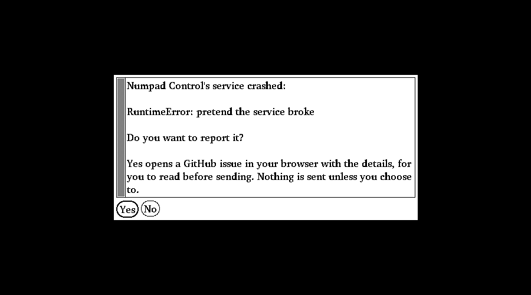

# Troubleshooting

Part of the [NumpadControl docs](../README.md).

## When something doesn't work
- **No sound from the microphone** (in OBS, a call, anywhere): run `tools/mic-level`, a live meter for the default
  microphone (`tools/mic-level SOURCE_NAME` for another; names from `pactl list short sources`). Stay quiet for the
  first 2 seconds (it measures the room), then talk or tap the microphone: it shows how far above the room each sound
  is, and when you stop it (Ctrl+C) it says whether the microphone works (15 dB or more above the room), is weak, or
  hears nothing but the room (a muted switch on the cable, the wrong jack, or a 4-pole headset plug in a 3-pole
  microphone jack). A microphone turned up all the way hears the whole room, so a bar that moves when you are not
  talking is normal: what matters is that your voice rises well above it. It only measures: nothing is recorded.
- **Key tester** lists, live, every press and release the numpad sends, with the time
  between them, and what the service made of it (→ `000`, for instance). Use it when a
  key does nothing or the `000` key doesn't register.
- **Diagnostics** collects one block of text for a bug report: version, system, whether
  the service runs and the numpad is connected, the keyboards the system sees (the
  configured numpad marked), USB set-up failures from the kernel log (Linux), keys with
  problems, and the last 50 log lines. **Copy** puts it on the clipboard. It never
  contains passwords.

## Games with anti-cheat
On Windows, while a game with anti-cheat runs (Valorant, Fortnite, Call of Duty,
Battlefield, Apex Legends and others, or any game using Easy Anti-Cheat, BattlEye or EA
Javelin), NumpadControl takes its keyboard hook out of the game's way: the numpad is
reopened without the hook DLL (the only part that Windows loads into other programs), so
**your actions keep working**, but the numpad's keys also type into the game until it
closes. Running programs are checked twice a second, launcher programs included, so the hook is
usually out before the game loads it. The hook comes back by itself when the game closes. The tray shows "Keys type
through while … runs (actions still work)". Settings: `"pause_for_games"` (`"auto"`: the
hook mode on Windows only; `"hook"`; `"full"` or `true`: let go of the numpad completely,
it then types like a normal keyboard and nothing is read; `false`: never) and
`"protected_games"` for more program names. This is not tested against real anti-cheat yet
(a VM can't do it: anti-cheat refuses them). Tested games and numpad models:
[docs/compatibility.md](compatibility.md); test a numpad with `python -m numpadctl check`.

## Privacy and crash reports
NumpadControl collects nothing: no telemetry, no usage statistics, no account. If a part
of it crashes, a plain system dialog asks whether to report that crash; **Yes** opens a
pre-filled GitHub issue in your browser, so you read everything before sending it, and
**No** sends nothing. The report (the error and where it happened, the version, the
system; your user name and home folder taken out) is also kept in
`~/.local/state/numpad-control/crashes/` (Windows: `%LOCALAPPDATA%\numpad-control\state\crashes`).
(`numpadctl/crash.py`; the plan's [section 12](plan-section-12-crash-reports.md).)

The only other times it uses the network: once a day it asks GitHub whether a new version exists (turn it off or
set it to only tell you with `"updates": "off"` / `"notify"` in `config.json`), and **Profile ⋯ → Browse library…**
downloads the profile list and the profile you pick from GitHub, only when you open it. Nothing about you is sent.
Stickers never leave your computer. The same text is on the [privacy page](https://youssefahmed2017.github.io/numpad-control/privacy.html).

