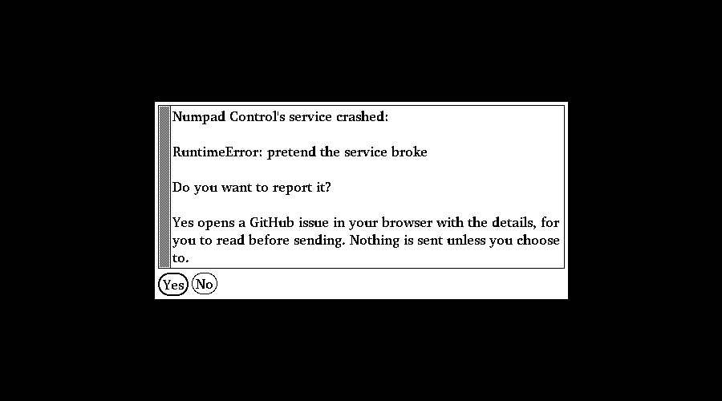

# Troubleshooting

Part of the [NumpadControl docs](../README.md).

## When something doesn't work
- **No sound from the microphone** (in OBS, a call, anywhere): run `tools/mic-level`, a live meter for the default
  microphone (`tools/mic-level SOURCE_NAME` for another; names from `pactl list short sources`). Stay quiet for the
  first 2 seconds (it measures the room), then talk or tap the microphone: it shows how far above the room each sound
  is, and when you stop it (Ctrl+C) it says whether the microphone works (15 dB or more above the room), is weak, or
  hears nothing but the room (a muted switch on the cable, the wrong jack, or a 4-pole headset plug in a 3-pole
  microphone jack). A microphone turned up all the way hears the whole room, so a bar that moves when you are not
  talking is normal: what matters is that your voice rises well above it. It only measures: nothing is recorded.
- **Key tester** lists, live, every press and release the numpad sends, with the time
  between them, and what the service made of it (→ `000`, for instance). Use it when a
  key does nothing or the `000` key doesn't register.
- **Diagnostics** collects one block of text for a bug report: version, system, whether
  the service runs and the numpad is connected, the keyboards the system sees (the
  configured numpad marked), USB set-up failures from the kernel log (Linux), keys with
  problems, and the last 50 log lines. **Copy** puts it on the clipboard. It never
  contains passwords.
- **The log** is a file on every system (Linux: `~/.local/state/numpad-control/numpad-control.log`, Windows: in
  `%LOCALAPPDATA%\numpad-control\state\`; Diagnostics prints the exact path), cut at 1 MB with the last two kept. **Tools →
  Copy the log** puts its last 200 lines on the clipboard, to paste into an issue. One line per press says what came
  of it and how long it took:

      2026-11-20 15:10:41 INFO    key 1 tap: open_browser -> ok (12 ms)
      2026-11-20 15:10:48 WARNING key 2 hold: open_url -> FAILED (35 ms): no URL set

  A failure from a program that gave no hint (it timed out, was refused, wasn't found, or may not be read) gets a
  second line, `clue: ...`, with the usual cause and the first thing to try. A key that isn't on the pad yet is
  explained once (turn on Learn and press it), and a key with nothing bound says which profile and layer it looked in.
  A key that the settings window takes is logged too: `key 1: selected in the settings window, not run: press it again
  within 1.5 s to run it`. While that window is in front with *Tools → Select a key when I press it* on (the default), a
  numpad key first only selects its key in the editor, so you can't fire Shut down by accident while setting it up; pressing
  the same key again within 1.5 seconds runs it. A hint in the top bar says so, and clicking it turns the selecting off.
  In Learn mode keys are only added, never run (`Learn mode is on in the settings window`), and while paused they are
  not run either (`NumpadControl is paused`).
- **The numpad does nothing at all?** Raise the log to debug: `NUMPADCTL_LOG=debug` in the service's environment
  (`systemctl --user edit numpad-control`, then `[Service]` and `Environment=NUMPADCTL_LOG=debug`), or
  `"log_level": "debug"` in `config.json`. Every raw key event is then logged (`raw: key 7 down`). If those lines appear
  when you press a key, the numpad reaches the program and the cause is a setting; if they do not, the key never
  arrived, which is the hardware or the USB connection, and no setting can fix that. A numpad that keeps dropping off
  USB (3 times in 10 minutes) is called out in the log with what to try: another port, straight into the back of the
  computer, another cable; `journalctl -k | grep -i usb` shows the kernel's side of it.

## Games with anti-cheat
On Windows, while a game with anti-cheat runs (Valorant, Fortnite, Call of Duty,
Battlefield, Apex Legends and others, or any game using Easy Anti-Cheat, BattlEye or EA
Javelin), NumpadControl takes its keyboard hook out of the game's way: the numpad is
reopened without the hook DLL (the only part that Windows loads into other programs), so
**your actions keep working**, but the numpad's keys also type into the game until it
closes. Running programs are checked twice a second, launcher programs included, so the hook is
usually out before the game loads it. The hook comes back by itself when the game closes. The tray shows "Keys type
through while … runs (actions still work)". Settings: `"pause_for_games"` (`"auto"`: the
hook mode on Windows only; `"hook"`; `"full"` or `true`: let go of the numpad completely,
it then types like a normal keyboard and nothing is read; `false`: never) and
`"protected_games"` for more program names. This is not tested against real anti-cheat yet
(a VM can't do it: anti-cheat refuses them). Tested games and numpad models:
[docs/compatibility.md](compatibility.md); test a numpad with `python -m numpadctl check`.

## Privacy and crash reports
NumpadControl collects nothing: no telemetry, no usage statistics, no account. If a part
of it crashes, a plain system dialog asks whether to report that crash; the dialog shows what would be
sent and **Yes** sends it to numpad.ahmedabdou.net (no account needed; listed on the
[Issues page](https://numpad.ahmedabdou.net/issues.html)), and **No** sends nothing. If you are offline the report
waits and you are asked again at the next start. The report (the error and where it happened, the version, the
system; your user name and home folder taken out) is also kept in
`~/.local/state/numpad-control/crashes/` (Windows: `%LOCALAPPDATA%\numpad-control\state\crashes`).
(`numpadctl/crash.py`; the plan's [section 12](plan-section-12-crash-reports.md).)

The only other times it uses the network: once a day it asks GitHub whether a new version exists (turn it off or
set it to only tell you with `"updates": "off"` / `"notify"` in `config.json`), and **Profile ⋯ → Browse library…**
downloads the profile list and the profile you pick from GitHub, only when you open it. Nothing about you is sent.
Stickers never leave your computer. The same text is on the [privacy page](https://numpad.ahmedabdou.net/privacy.html).

